# Routeplane experiment report

Generated 2026-11-02T13:41:42.390862494Z from 118 recorded runs. Every number below is computed from the per-run JSON files in `runs/`; nothing is estimated or simulated.

## Environment

| property | value |
| --- | --- |
| capturedAt | 2026-11-02T12:26:34.962032491Z |
| os | Linux 6.1.158+ amd64 |
| kernel | Linux version 6.1.158+ (root@runnervmeorf1) (gcc (Ubuntu 13.3.0-6ubuntu2~24.04.1) 13.3.0, GNU ld (GNU Binutils for Ubuntu) 2.42) #1 SMP PREEMPT_DYNAMIC Mon May 11 18:48:24 UTC 2026 |
| cpuModel | Intel(R) Xeon(R) Processor @ 2.60GHz |
| availableProcessors | 2.0 |
| memTotalMb | 3939.0 |
| cgroupCpuMax | n/a |
| cgroupMemoryMax | n/a |
| runnerJava | 21.0.8 (Eclipse Adoptium, OpenJDK 64-Bit Server VM) |
| loadGenerator | dev.routeplane.bench.LoadGenerator: open-loop, JDK HttpClient (HTTP/1.1), virtual-thread executor, latency measured from intended send time |
| topology | load generator, proxy and upstreams run on the SAME machine as separate processes; they compete for the same CPUs |
| git | ac5c47e |
| invocation 1 | --out experiments/results/campaign-2026-11-02 --work /home/user/.cache/rp-work  [scenarios: [basic,breaker-shadow,breaker,direct,fail-503,fail-capacity,fail-gradual-recovery,fail-outage,fail-retry-amplification,fail-shadow-down,fail-shadow-saturated,fail-slow,shadow,weighted]] |
| invocation 2 | --out experiments/results/campaign-2026-11-02 --work /home/user/.cache/rp-work --only fail-retry-amplification,fail-shadow-down,fail-shadow-saturated,fail-slow,shadow,weighted  [scenarios: [fail-retry-amplification,fail-shadow-down,fail-shadow-saturated,fail-slow,shadow,weighted]]  NOTE: Resumed: the first invocation aborted when fail-retry-amplification@retry-unbudgeted could not start, because the scenario set minRetriesPerSecond: 100000, above the configuration's documented maximum of 10000 (the proxy's strict validation refused it). The scenario was corrected to 10000 and the remaining scenarios were run here; fail-retry-amplification@no-retry was run again and its two runs replaced the earlier two. |

## How to read this report

- **Open-loop load.** Requests are sent on a fixed schedule independent of responses; latency is measured from the *intended* send time, so stalls are not hidden (coordinated omission). If the generator itself falls behind it says so (flag `GENERATOR-LAG`).
- **Shared hardware.** The load generator, the proxy and the upstreams run on the same machine and compete for the same CPUs. Absolute numbers describe *this setup only*; the useful information is the relative difference between experiments measured under identical conditions.
- **Percentiles are only reported when the run has enough samples:** p99 needs at least 1,000 responses and p99.9 at least 10,000 (ten observations in the tail). Otherwise the cell shows `n/a`.
- **Saturation** is flagged when achieved throughput is below 95% of the offered rate, more than 1% of requests time out, or the generator had to drop requests. Latencies of saturated runs are lower bounds for what a client would experience and are shown but should not be compared with unsaturated runs.
- **Repetitions.** Cells show the median over the repetitions with the min-max range in brackets where useful. High variance between repetitions is called out.
- **Error attribution.** Responses are classified by origin: *upstream-originated* (error status produced by an upstream and passed through), *proxy-generated, upstream-caused* (502/504 for connect failures, resets, timeouts), *proxy-generated, protective* (503 for open breaker, no healthy upstream, concurrency limit, overload) and *transport* (client-side timeouts and connection errors). Upstream responses cannot carry the proxy marker header, so the split is reliable.
- **CPU, memory and GC** come from `/proc` and the proxy's `/metrics`; CPU is expressed as a percentage of the whole machine.

## Steady-state experiments

### basic

Proxy with one upstream, round-robin, no retries, no circuit breaker, no shadowing: the cost of the proxy hop itself.

| offered rps | runs | achieved rps | success % | p50 ms | p95 ms | p99 ms | p99.9 ms | max ms | proxy CPU % of machine | proxy RSS MB | heap MB | GCs | flags |
| --- | --- | --- | --- | --- | --- | --- | --- | --- | --- | --- | --- | --- | --- |
| 100 | 3 | 100 [100-100] | 100.0 | 9.30 | 12.29 | 18.64 [16.2-21.0] | n/a | 41.0 | 9.8 | 179 | 74 | 3 | FEW-SAMPLES |
| 500 | 3 | 500 [500-500] | 100.0 | 9.18 | 13.58 | 35.58 [29.2-54.6] | n/a | 86.1 | 24.2 | 307 | 181 | 4 | FEW-SAMPLES |
| 1000 | 3 | 1000 [1000-1000] | 100.0 | 10.36 | 141.44 | 220.29 [163.2-319.5] | 261.5 | 292.1 | 33.5 | 470 | 272 | 4 |  |
| 2500 | 3 | 1739 [1513-1750] | 69.6 | 1488.90 | 2433.02 | 2816.00 [2584.6-4243.5] | 3002.4 | 3026.9 | 46.9 | 483 | 281 | 23 | SATURATED, GENERATOR-LAG, MACHINE-CPU-SATURATED |
| 5000 | 1 | 1539 | 30.8 | 1748.99 | 2555.90 | 3012.61 | 3201.0 | 3346.4 | 47.7 | 642 | 373 | 13 | SATURATED, GENERATOR-LAG, MACHINE-CPU-SATURATED |
| 10000 | 1 | 1282 | 12.8 | 2334.72 | 3614.72 | 4296.70 | 4640.8 | 4726.8 | 45.6 | 640 | 404 | 15 | SATURATED, GENERATOR-LAG, MACHINE-CPU-SATURATED |

- tier 100 (run 1): FEW-SAMPLES: 1000 responses; p99.9 is not reported (needs 10000)
- tier 500 (run 1): FEW-SAMPLES: 5000 responses; p99.9 is not reported (needs 10000)
- tier 500: HIGH-VARIANCE: p99 varies by 33% (coefficient of variation) across 3 runs
- tier 1000: HIGH-VARIANCE: p99 varies by 34% (coefficient of variation) across 3 runs
- tier 2500 (run 1): SATURATED: achieved 1513 of 2500 rps offered, generator dropped 9868
- tier 2500 (run 1): GENERATOR-LAG: the load generator sent requests up to 99 ms (p99) after their intended time; latencies at this rate include that delay
- tier 2500 (run 1): MACHINE-CPU-SATURATED: all CPUs were 99% busy (generator, proxy and upstreams share them)
- tier 2500: HIGH-VARIANCE: p99 varies by 28% (coefficient of variation) across 3 runs
- tier 5000 (run 1): SATURATED: achieved 1539 of 5000 rps offered, generator dropped 34611
- tier 5000 (run 1): GENERATOR-LAG: the load generator sent requests up to 94 ms (p99) after their intended time; latencies at this rate include that delay
- tier 5000 (run 1): MACHINE-CPU-SATURATED: all CPUs were 99% busy (generator, proxy and upstreams share them)
- tier 10000 (run 1): SATURATED: achieved 1282 of 10000 rps offered, generator dropped 87183
- tier 10000 (run 1): GENERATOR-LAG: the load generator sent requests up to 190 ms (p99) after their intended time; latencies at this rate include that delay
- tier 10000 (run 1): MACHINE-CPU-SATURATED: all CPUs were 100% busy (generator, proxy and upstreams share them)

### breaker-shadow

Weighted routing with circuit breaker and passive health, plus 25% shadowing.

| offered rps | runs | achieved rps | success % | p50 ms | p95 ms | p99 ms | p99.9 ms | max ms | proxy CPU % of machine | proxy RSS MB | heap MB | GCs | flags |
| --- | --- | --- | --- | --- | --- | --- | --- | --- | --- | --- | --- | --- | --- |
| 100 | 3 | 100 [100-100] | 100.0 | 9.24 | 12.23 | 19.73 [13.2-20.8] | n/a | 30.8 | 12.4 | 263 | 146 | 1 | FEW-SAMPLES |
| 500 | 3 | 500 [500-500] | 100.0 | 9.34 | 30.42 | 76.35 [59.1-128.2] | n/a | 149.0 | 25.4 | 335 | 190 | 3 | FEW-SAMPLES |
| 1000 | 3 | 1000 [1000-1000] | 100.0 | 62.18 | 1264.64 | 1428.48 [688.1-2066.4] | 1499.1 | 1549.3 | 45.4 | 433 | 220 | 8 | GENERATOR-LAG, MACHINE-CPU-SATURATED |
| 2500 | 3 | 980 [897-1094] | 39.1 | 2836.48 | 4214.78 | 4628.48 [3995.6-4956.2] | 4137.0 | 5017.6 | 42.4 | 629 | 373 | 20 | SATURATED, GENERATOR-LAG, MACHINE-CPU-SATURATED, FEW-SAMPLES |
| 5000 | 1 | 943 | 18.7 | 2682.88 | 4734.98 | 4927.49 | n/a | 5046.3 | 41.9 | 655 | 366 | 20 | SATURATED, GENERATOR-LAG, MACHINE-CPU-SATURATED, FEW-SAMPLES |
| 10000 | 1 | 937 | 9.4 | 2813.95 | 3219.46 | 4069.38 | n/a | 5001.2 | 42.3 | 648 | 440 | 20 | SATURATED, GENERATOR-LAG, MACHINE-CPU-SATURATED, FEW-SAMPLES |

- tier 100 (run 1): FEW-SAMPLES: 1000 responses; p99.9 is not reported (needs 10000)
- tier 500 (run 1): FEW-SAMPLES: 5000 responses; p99.9 is not reported (needs 10000)
- tier 500: HIGH-VARIANCE: p99 varies by 41% (coefficient of variation) across 3 runs
- tier 1000 (run 1): GENERATOR-LAG: the load generator sent requests up to 51 ms (p99) after their intended time; latencies at this rate include that delay
- tier 1000: HIGH-VARIANCE: p99 varies by 49% (coefficient of variation) across 3 runs
- tier 2500 (run 1): SATURATED: achieved 1094 of 2500 rps offered, generator dropped 14059
- tier 2500 (run 1): GENERATOR-LAG: the load generator sent requests up to 79 ms (p99) after their intended time; latencies at this rate include that delay
- tier 2500 (run 1): MACHINE-CPU-SATURATED: all CPUs were 100% busy (generator, proxy and upstreams share them)
- tier 5000 (run 1): SATURATED: achieved 943 of 5000 rps offered, generator dropped 40572
- tier 5000 (run 1): GENERATOR-LAG: the load generator sent requests up to 103 ms (p99) after their intended time; latencies at this rate include that delay
- tier 5000 (run 1): MACHINE-CPU-SATURATED: all CPUs were 99% busy (generator, proxy and upstreams share them)
- tier 5000 (run 1): FEW-SAMPLES: 9428 responses; p99.9 is not reported (needs 10000)
- tier 10000 (run 1): SATURATED: achieved 937 of 10000 rps offered, generator dropped 90631
- tier 10000 (run 1): GENERATOR-LAG: the load generator sent requests up to 89 ms (p99) after their intended time; latencies at this rate include that delay
- tier 10000 (run 1): MACHINE-CPU-SATURATED: all CPUs were 100% busy (generator, proxy and upstreams share them)
- tier 10000 (run 1): FEW-SAMPLES: 9369 responses; p99.9 is not reported (needs 10000)

### breaker

Weighted routing plus a per-upstream circuit breaker and passive health on healthy upstreams: the overhead of the resilience machinery when nothing is failing.

| offered rps | runs | achieved rps | success % | p50 ms | p95 ms | p99 ms | p99.9 ms | max ms | proxy CPU % of machine | proxy RSS MB | heap MB | GCs | flags |
| --- | --- | --- | --- | --- | --- | --- | --- | --- | --- | --- | --- | --- | --- |
| 100 | 3 | 100 [100-100] | 100.0 | 9.36 | 12.68 | 33.73 [14.5-45.2] | n/a | 63.2 | 12.1 | 266 | 134 | 2 | FEW-SAMPLES |
| 500 | 3 | 500 [500-500] | 100.0 | 9.28 | 20.18 | 56.64 [50.3-251.1] | n/a | 99.6 | 22.0 | 290 | 164 | 4 | FEW-SAMPLES |
| 1000 | 3 | 1000 [953-1000] | 100.0 | 1880.06 | 2942.98 | 3514.37 [1481.7-3835.9] | 2819.1 | 3962.9 | 41.7 | 530 | 331 | 14 | SATURATED, GENERATOR-LAG, FEW-SAMPLES, MACHINE-CPU-SATURATED |
| 2500 | 3 | 998 [931-1154] | 38.2 | 2689.02 | 4194.30 | 4706.30 [3076.1-5005.3] | 3354.6 | 5115.9 | 41.0 | 577 | 320 | 19 | SATURATED, GENERATOR-LAG, MACHINE-CPU-SATURATED, FEW-SAMPLES |
| 5000 | 1 | 1270 | 25.4 | 2113.54 | 2969.60 | 3377.15 | 3446.8 | 3835.9 | 44.2 | 476 | 262 | 20 | SATURATED, GENERATOR-LAG, MACHINE-CPU-SATURATED |
| 10000 | 1 | 939 | 9.4 | 3082.24 | 4304.90 | 4513.79 | n/a | 5664.8 | 40.1 | 569 | 315 | 14 | SATURATED, GENERATOR-LAG, MACHINE-CPU-SATURATED, FEW-SAMPLES |

- tier 100 (run 1): FEW-SAMPLES: 1000 responses; p99.9 is not reported (needs 10000)
- tier 100: HIGH-VARIANCE: p99 varies by 50% (coefficient of variation) across 3 runs
- tier 500 (run 1): FEW-SAMPLES: 5000 responses; p99.9 is not reported (needs 10000)
- tier 500: HIGH-VARIANCE: p99 varies by 96% (coefficient of variation) across 3 runs
- tier 1000 (run 1): SATURATED: achieved 953 of 1000 rps offered, generator dropped 470
- tier 1000 (run 1): GENERATOR-LAG: the load generator sent requests up to 100 ms (p99) after their intended time; latencies at this rate include that delay
- tier 1000 (run 1): FEW-SAMPLES: 9530 responses; p99.9 is not reported (needs 10000)
- tier 1000: HIGH-VARIANCE: p99 varies by 43% (coefficient of variation) across 3 runs
- tier 2500 (run 1): SATURATED: achieved 1154 of 2500 rps offered, generator dropped 13460
- tier 2500 (run 1): GENERATOR-LAG: the load generator sent requests up to 185 ms (p99) after their intended time; latencies at this rate include that delay
- tier 2500 (run 1): MACHINE-CPU-SATURATED: all CPUs were 97% busy (generator, proxy and upstreams share them)
- tier 5000 (run 1): SATURATED: achieved 1270 of 5000 rps offered, generator dropped 37305
- tier 5000 (run 1): GENERATOR-LAG: the load generator sent requests up to 44 ms (p99) after their intended time; latencies at this rate include that delay
- tier 5000 (run 1): MACHINE-CPU-SATURATED: all CPUs were 99% busy (generator, proxy and upstreams share them)
- tier 10000 (run 1): SATURATED: achieved 939 of 10000 rps offered, generator dropped 90606
- tier 10000 (run 1): GENERATOR-LAG: the load generator sent requests up to 618 ms (p99) after their intended time; latencies at this rate include that delay
- tier 10000 (run 1): MACHINE-CPU-SATURATED: all CPUs were 97% busy (generator, proxy and upstreams share them)
- tier 10000 (run 1): FEW-SAMPLES: 9394 responses; p99.9 is not reported (needs 10000)

### direct

Baseline. The load generator talks to one fault-injection upstream directly, with no proxy. Everything the proxy experiments add is measured against this.

| offered rps | runs | achieved rps | success % | p50 ms | p95 ms | p99 ms | p99.9 ms | max ms | proxy CPU % of machine | proxy RSS MB | heap MB | GCs | flags |
| --- | --- | --- | --- | --- | --- | --- | --- | --- | --- | --- | --- | --- | --- |
| 100 | 3 | 100 [100-100] | 100.0 | 8.27 | 11.54 | 12.58 [12.4-14.9] | n/a | 19.8 | 0.0 | 0 | 0 | 0 | FEW-SAMPLES |
| 500 | 3 | 500 [500-500] | 100.0 | 8.60 | 11.09 | 11.85 [11.7-11.9] | n/a | 22.2 | 0.0 | 0 | 0 | 0 | FEW-SAMPLES |
| 1000 | 3 | 1000 [1000-1000] | 100.0 | 8.62 | 11.02 | 12.20 [11.2-16.1] | 21.6 | 25.8 | 0.0 | 0 | 0 | 0 |  |
| 2500 | 3 | 2500 [2500-2500] | 100.0 | 8.63 | 11.10 | 14.22 [13.9-20.8] | 24.1 | 31.8 | 0.0 | 0 | 0 | 0 |  |
| 5000 | 1 | 5000 | 100.0 | 39.01 | 80.19 | 101.06 | 132.0 | 160.5 | 0.0 | 0 | 0 | 0 |  |
| 10000 | 1 | 4630 | 46.3 | 643.07 | 908.29 | 1137.66 | 1245.2 | 1329.2 | 0.0 | 0 | 0 | 0 | SATURATED, GENERATOR-LAG, MACHINE-CPU-SATURATED |

- tier 100 (run 1): FEW-SAMPLES: 1000 responses; p99.9 is not reported (needs 10000)
- tier 500 (run 1): FEW-SAMPLES: 5000 responses; p99.9 is not reported (needs 10000)
- tier 10000 (run 1): SATURATED: achieved 4630 of 10000 rps offered, generator dropped 53699
- tier 10000 (run 1): GENERATOR-LAG: the load generator sent requests up to 29 ms (p99) after their intended time; latencies at this rate include that delay
- tier 10000 (run 1): MACHINE-CPU-SATURATED: all CPUs were 92% busy (generator, proxy and upstreams share them)

### shadow

Basic proxy that mirrors 25% of requests to a shadow target: the cost of shadowing to the primary path.

| offered rps | runs | achieved rps | success % | p50 ms | p95 ms | p99 ms | p99.9 ms | max ms | proxy CPU % of machine | proxy RSS MB | heap MB | GCs | flags |
| --- | --- | --- | --- | --- | --- | --- | --- | --- | --- | --- | --- | --- | --- |
| 100 | 3 | 100 [100-100] | 100.0 | 9.10 | 11.90 | 14.89 [14.0-15.0] | n/a | 58.2 | 10.8 | 196 | 82 | 1 | FEW-SAMPLES |
| 500 | 3 | 500 [500-500] | 100.0 | 9.13 | 12.99 | 30.78 [21.6-58.7] | n/a | 79.7 | 21.1 | 322 | 161 | 2 | FEW-SAMPLES |
| 1000 | 3 | 1000 [1000-1000] | 100.0 | 10.50 | 147.33 | 276.99 [208.0-290.0] | 368.6 | 389.1 | 41.4 | 432 | 274 | 6 |  |
| 2500 | 3 | 1417 [1293-1463] | 56.6 | 1762.30 | 2852.86 | 3606.53 [2756.6-4247.6] | 4005.9 | 4048.9 | 48.1 | 559 | 364 | 13 | SATURATED, GENERATOR-LAG, MACHINE-CPU-SATURATED |
| 5000 | 1 | 1337 | 26.7 | 1883.14 | 3241.98 | 3835.90 | 3917.8 | 3930.1 | 47.7 | 584 | 336 | 17 | SATURATED, GENERATOR-LAG, MACHINE-CPU-SATURATED |
| 10000 | 1 | 1149 | 11.5 | 2027.52 | 3596.29 | 4616.19 | 5066.8 | 5083.1 | 45.4 | 606 | 326 | 15 | SATURATED, GENERATOR-LAG, MACHINE-CPU-SATURATED |

- tier 100 (run 1): FEW-SAMPLES: 1000 responses; p99.9 is not reported (needs 10000)
- tier 500 (run 1): FEW-SAMPLES: 5000 responses; p99.9 is not reported (needs 10000)
- tier 500: HIGH-VARIANCE: p99 varies by 52% (coefficient of variation) across 3 runs
- tier 2500 (run 1): SATURATED: achieved 1293 of 2500 rps offered, generator dropped 12070
- tier 2500 (run 1): GENERATOR-LAG: the load generator sent requests up to 132 ms (p99) after their intended time; latencies at this rate include that delay
- tier 2500 (run 1): MACHINE-CPU-SATURATED: all CPUs were 99% busy (generator, proxy and upstreams share them)
- tier 5000 (run 1): SATURATED: achieved 1337 of 5000 rps offered, generator dropped 36627
- tier 5000 (run 1): GENERATOR-LAG: the load generator sent requests up to 237 ms (p99) after their intended time; latencies at this rate include that delay
- tier 5000 (run 1): MACHINE-CPU-SATURATED: all CPUs were 99% busy (generator, proxy and upstreams share them)
- tier 10000 (run 1): SATURATED: achieved 1149 of 10000 rps offered, generator dropped 88509
- tier 10000 (run 1): GENERATOR-LAG: the load generator sent requests up to 307 ms (p99) after their intended time; latencies at this rate include that delay
- tier 10000 (run 1): MACHINE-CPU-SATURATED: all CPUs were 100% busy (generator, proxy and upstreams share them)

### weighted

Proxy with three upstreams and smooth weighted round-robin (50/30/20): routing across several upstreams, no resilience features.

| offered rps | runs | achieved rps | success % | p50 ms | p95 ms | p99 ms | p99.9 ms | max ms | proxy CPU % of machine | proxy RSS MB | heap MB | GCs | flags |
| --- | --- | --- | --- | --- | --- | --- | --- | --- | --- | --- | --- | --- | --- |
| 100 | 3 | 100 [100-100] | 100.0 | 9.32 | 12.51 | 22.40 [14.2-29.3] | n/a | 45.5 | 11.2 | 260 | 142 | 3 | FEW-SAMPLES |
| 500 | 3 | 500 [500-500] | 100.0 | 9.21 | 15.74 | 57.54 [37.9-70.6] | n/a | 98.5 | 23.1 | 294 | 168 | 5 | FEW-SAMPLES |
| 1000 | 3 | 1000 [1000-1000] | 100.0 | 21.52 | 807.42 | 1139.71 [364.5-1401.9] | 1241.1 | 1267.7 | 44.7 | 413 | 216 | 12 | GENERATOR-LAG, MACHINE-CPU-SATURATED |
| 2500 | 3 | 1173 [1152-1381] | 46.9 | 2056.19 | 3493.89 | 4239.36 [3209.2-4259.8] | 4427.8 | 4595.7 | 43.7 | 586 | 363 | 18 | SATURATED, GENERATOR-LAG, MACHINE-CPU-SATURATED |
| 5000 | 1 | 1055 | 21.1 | 2578.43 | 3366.91 | 3858.43 | 3983.4 | 4001.8 | 43.0 | 560 | 316 | 16 | SATURATED, GENERATOR-LAG, MACHINE-CPU-SATURATED |
| 10000 | 1 | 985 | 9.9 | 2605.06 | 4370.43 | 4497.41 | n/a | 4657.2 | 46.0 | 507 | 291 | 27 | SATURATED, GENERATOR-LAG, MACHINE-CPU-SATURATED, FEW-SAMPLES |

- tier 100 (run 1): FEW-SAMPLES: 1000 responses; p99.9 is not reported (needs 10000)
- tier 100: HIGH-VARIANCE: p99 varies by 34% (coefficient of variation) across 3 runs
- tier 500 (run 1): FEW-SAMPLES: 5000 responses; p99.9 is not reported (needs 10000)
- tier 500: HIGH-VARIANCE: p99 varies by 30% (coefficient of variation) across 3 runs
- tier 1000: HIGH-VARIANCE: p99 varies by 56% (coefficient of variation) across 3 runs
- tier 2500 (run 1): SATURATED: achieved 1381 of 2500 rps offered, generator dropped 11186
- tier 2500 (run 1): GENERATOR-LAG: the load generator sent requests up to 108 ms (p99) after their intended time; latencies at this rate include that delay
- tier 2500 (run 1): MACHINE-CPU-SATURATED: all CPUs were 99% busy (generator, proxy and upstreams share them)
- tier 5000 (run 1): SATURATED: achieved 1055 of 5000 rps offered, generator dropped 39450
- tier 5000 (run 1): GENERATOR-LAG: the load generator sent requests up to 248 ms (p99) after their intended time; latencies at this rate include that delay
- tier 5000 (run 1): MACHINE-CPU-SATURATED: all CPUs were 99% busy (generator, proxy and upstreams share them)
- tier 10000 (run 1): SATURATED: achieved 985 of 10000 rps offered, generator dropped 90147
- tier 10000 (run 1): GENERATOR-LAG: the load generator sent requests up to 362 ms (p99) after their intended time; latencies at this rate include that delay
- tier 10000 (run 1): MACHINE-CPU-SATURATED: all CPUs were 99% busy (generator, proxy and upstreams share them)
- tier 10000 (run 1): FEW-SAMPLES: 9853 responses; p99.9 is not reported (needs 10000)

### Comparison across experiments

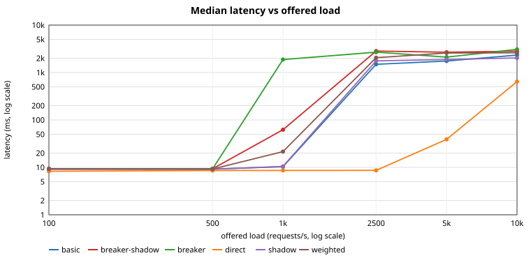

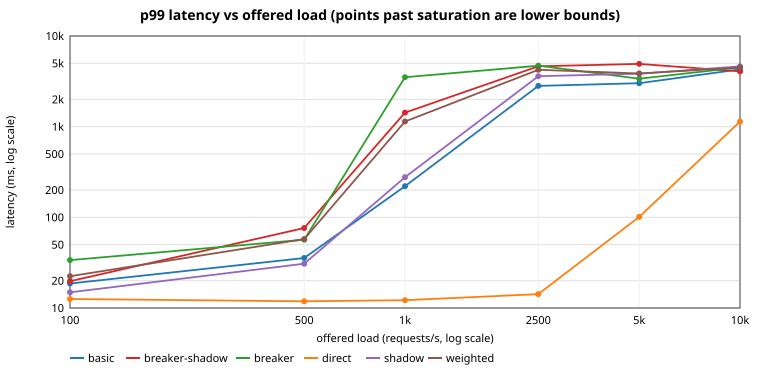

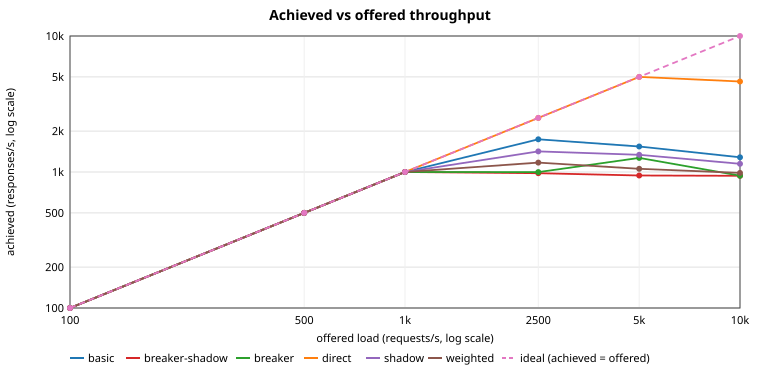

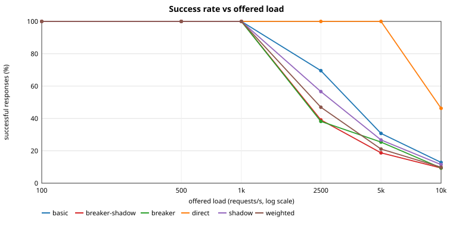

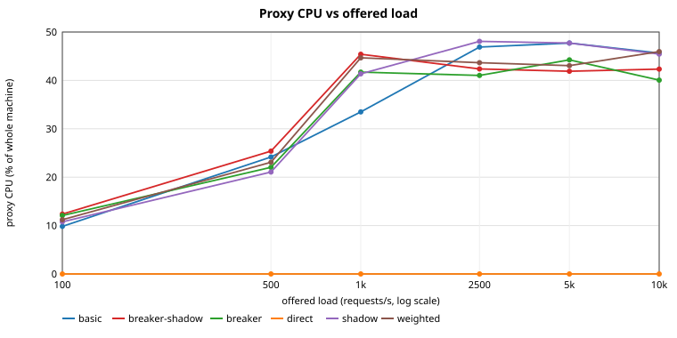

### Overhead relative to the direct baseline (direct)

Latency differences are *proxy hop cost* (extra milliseconds at the same offered load); rows where either side was saturated are flagged in the per-experiment tables above and should be read with care.

| offered rps | experiment | p50 delta | p99 delta | achieved rps (this vs direct) | proxy CPU ms per request |
| --- | --- | --- | --- | --- | --- |
| 100 | basic | +1.03 ms | +6.06 ms | 100 vs 100 | 1.965 |
| 100 | breaker-shadow | +0.97 ms | +7.15 ms | 100 vs 100 | 2.474 |
| 100 | breaker | +1.09 ms | +21.15 ms | 100 vs 100 | 2.414 |
| 100 | shadow | +0.82 ms | +2.31 ms | 100 vs 100 | 2.153 |
| 100 | weighted | +1.05 ms | +9.82 ms | 100 vs 100 | 2.243 |
| 500 | basic | +0.58 ms | +23.74 ms | 500 vs 500 | 0.967 |
| 500 | breaker-shadow | +0.74 ms | +64.50 ms | 500 vs 500 | 1.015 |
| 500 | breaker | +0.68 ms | +44.79 ms | 500 vs 500 | 0.881 |
| 500 | shadow | +0.53 ms | +18.94 ms | 500 vs 500 | 0.842 |
| 500 | weighted | +0.61 ms | +45.69 ms | 500 vs 500 | 0.923 |
| 1000 | basic | +1.74 ms | +208.09 ms | 1000 vs 1000 | 0.670 |
| 1000 | breaker-shadow | +53.56 ms | +1416.28 ms | 1000 vs 1000 | 0.908 |
| 1000 | breaker | +1871.45 ms | +3502.17 ms | 1000 vs 1000 | 0.834 |
| 1000 | shadow | +1.88 ms | +264.79 ms | 1000 vs 1000 | 0.827 |
| 1000 | weighted | +12.90 ms | +1127.51 ms | 1000 vs 1000 | 0.893 |
| 2500 | basic | +1480.26 ms | +2801.78 ms | 1739 vs 2500 | 0.539 |
| 2500 | breaker-shadow | +2827.85 ms | +4614.26 ms | 980 vs 2500 | 0.885 |
| 2500 | breaker | +2680.39 ms | +4692.08 ms | 998 vs 2500 | 0.822 |
| 2500 | shadow | +1753.67 ms | +3592.30 ms | 1417 vs 2500 | 0.701 |
| 2500 | weighted | +2047.56 ms | +4225.14 ms | 1173 vs 2500 | 0.730 |
| 5000 | basic | +1709.98 ms | +2911.55 ms | 1539 vs 5000 | 0.620 |
| 5000 | breaker-shadow | +2643.87 ms | +4826.43 ms | 943 vs 5000 | 0.889 |
| 5000 | breaker | +2074.53 ms | +3276.10 ms | 1270 vs 5000 | 0.697 |
| 5000 | shadow | +1844.13 ms | +3734.85 ms | 1337 vs 5000 | 0.714 |
| 5000 | weighted | +2539.42 ms | +3757.38 ms | 1055 vs 5000 | 0.816 |
| 10000 | basic | +1691.65 ms | +3159.04 ms | 1282 vs 4630 | 0.712 |
| 10000 | breaker-shadow | +2170.88 ms | +2931.71 ms | 937 vs 4630 | 0.904 |
| 10000 | breaker | +2439.17 ms | +3376.13 ms | 939 vs 4630 | 0.853 |
| 10000 | shadow | +1384.45 ms | +3478.53 ms | 1149 vs 4630 | 0.791 |
| 10000 | weighted | +1961.98 ms | +3359.74 ms | 985 vs 4630 | 0.933 |

## Failure scenarios

Each scenario applies a controlled fault to an upstream at a fixed time inside the measurement window and (usually) lifts it later. Phase tables split the window into *before*, *during* and *after* the fault; the charts show the success rate and p99 latency second by second with the fault events marked.

### fail-503

Upstream a answers every request with HTTP 503 from 8 s to 24 s.

| t (s) | event | detail |
| --- | --- | --- |
| 8.0 | a returns 503 | a: {errorRate=1.0, errorStatus=503} |
| 24.1 | a healthy | a: {errorRate=0.0} |

| variant | phase | runs | success % | upstream-originated error % | proxy-generated error % | transport error % | p99 latency ms (worst second) |
| --- | --- | --- | --- | --- | --- | --- | --- |
| baseline | before fault | 2 | 100.0 | 0.0 | 0.0 | 0.0 | 473.1 |
| baseline | during fault | 2 | 66.7 | 33.3 | 0.0 | 0.0 | 55.7 |
| baseline | after recovery event | 2 | 99.9 | 0.1 | 0.0 | 0.0 | 38.7 |
| resilient | before fault | 2 | 100.0 | 0.0 | 0.0 | 0.0 | 330.8 |
| resilient | during fault | 2 | 100.0 | 0.0 | 0.0 | 0.0 | 56.3 |
| resilient | after recovery event | 2 | 100.0 | 0.0 | 0.0 | 0.0 | 26.2 |

| variant | whole window: proxy-generated % (upstream-caused / protective) | retry amplification (upstream attempts per request) | recovery time | shadow queue max | shadow dropped | breaker transitions |
| --- | --- | --- | --- | --- | --- | --- |
| baseline | 0.0 / 0.0 | 1.000 | 0.5 s | 0 | 0 | 0 |
| resilient | 0.0 / 0.0 | 1.001 | 0.0 s | 0 | 0 | 0 |

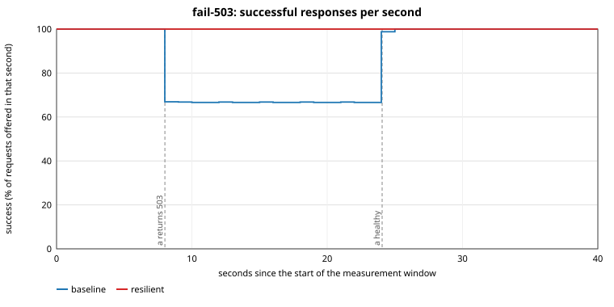

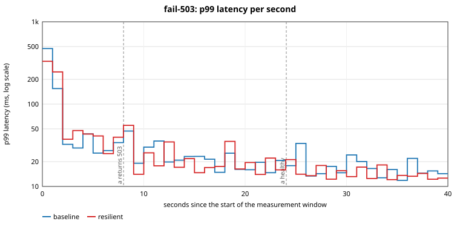

### fail-capacity

Upstream a loses capacity: its concurrency limit drops from unlimited to 4 (about half of what its share of the traffic needs) from 8 s to 24 s; excess requests are answered 503 immediately.

| t (s) | event | detail |
| --- | --- | --- |
| 8.0 | a capacity reduced | a: {maxConcurrency=4, queueWaitMs=0} |
| 24.0 | a capacity restored | a: {maxConcurrency=0} |

| variant | phase | runs | success % | upstream-originated error % | proxy-generated error % | transport error % | p99 latency ms (worst second) |
| --- | --- | --- | --- | --- | --- | --- | --- |
| baseline | before fault | 2 | 100.0 | 0.0 | 0.0 | 0.0 | 647.2 |
| baseline | during fault | 2 | 82.7 | 17.3 | 0.0 | 0.0 | 93.4 |
| baseline | after recovery event | 2 | 99.9 | 0.1 | 0.0 | 0.0 | 139.0 |
| resilient | before fault | 2 | 100.0 | 0.0 | 0.0 | 0.0 | 327.2 |
| resilient | during fault | 2 | 100.0 | 0.0 | 0.0 | 0.0 | 165.9 |
| resilient | after recovery event | 2 | 100.0 | 0.0 | 0.0 | 0.0 | 102.7 |

| variant | whole window: proxy-generated % (upstream-caused / protective) | retry amplification (upstream attempts per request) | recovery time | shadow queue max | shadow dropped | breaker transitions |
| --- | --- | --- | --- | --- | --- | --- |
| baseline | 0.0 / 0.0 | 1.001 | 0.4 s | 0 | 0 | 0 |
| resilient | 0.0 / 0.0 | 1.003 | 0.0 s | 0 | 0 | 11 |

Breaker transitions in run 1 of `fail-capacity@resilient`: a closed->open at 11.4s (failure_rate_exceeded); a open->half_open at 14.4s (open_duration_elapsed); a half_open->closed at 14.5s (recovered); a closed->open at 14.6s (failure_rate_exceeded); a open->half_open at 17.6s (open_duration_elapsed); a half_open->closed at 17.7s (recovered); a closed->open at 17.8s (failure_rate_exceeded); a open->half_open at 20.8s (open_duration_elapsed); a half_open->closed at 20.9s (recovered); a closed->open at 21.0s (failure_rate_exceeded); a open->half_open at 24.0s (open_duration_elapsed); a half_open->closed at 24.1s (recovered)

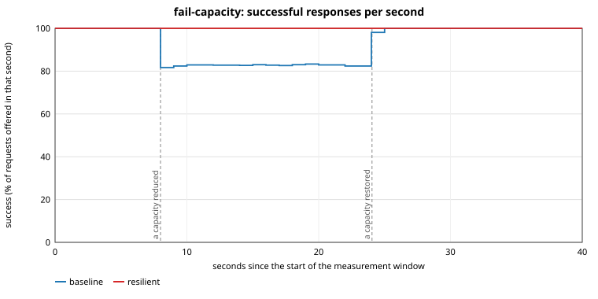

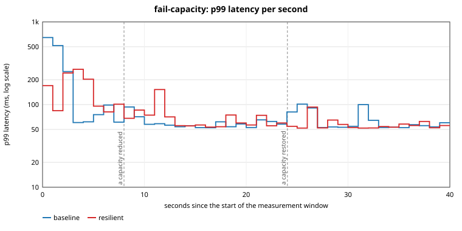

### fail-gradual-recovery

Upstream a fails every request with 500 from 8 s; at 16 s it begins a gradual recovery in which the error rate falls linearly to zero over 15 s.

| t (s) | event | detail |
| --- | --- | --- |
| 8.0 | a failing | a: {errorRate=1.0, errorStatus=500} |
| 16.1 | a recovering (15 s ramp) | a: gradual recovery over 15000 ms |

| variant | phase | runs | success % | upstream-originated error % | proxy-generated error % | transport error % | p99 latency ms (worst second) |
| --- | --- | --- | --- | --- | --- | --- | --- |
| baseline | before fault | 2 | 100.0 | 0.0 | 0.0 | 0.0 | 337.9 |
| baseline | during fault | 2 | 66.7 | 33.3 | 0.0 | 0.0 | 43.8 |
| baseline | after recovery event | 2 | 89.2 | 10.8 | 0.0 | 0.0 | 75.9 |
| resilient | before fault | 2 | 100.0 | 0.0 | 0.0 | 0.0 | 450.8 |
| resilient | during fault | 2 | 99.8 | 0.2 | 0.0 | 0.0 | 63.5 |
| resilient | after recovery event | 2 | 99.7 | 0.3 | 0.0 | 0.0 | 39.9 |

| variant | whole window: proxy-generated % (upstream-caused / protective) | retry amplification (upstream attempts per request) | recovery time | shadow queue max | shadow dropped | breaker transitions |
| --- | --- | --- | --- | --- | --- | --- |
| baseline | 0.0 / 0.0 | 1.000 | 14.9 s | 0 | 0 | 0 |
| resilient | 0.0 / 0.0 | 1.000 | 2.5 s | 0 | 0 | 3 |

Breaker transitions in run 1 of `fail-gradual-recovery@resilient`: a closed->open at 23.2s (failure_rate_exceeded); a open->half_open at 26.2s (open_duration_elapsed); a half_open->open at 26.2s (probe_failed); a open->half_open at 29.2s (open_duration_elapsed); a half_open->closed at 29.3s (recovered)

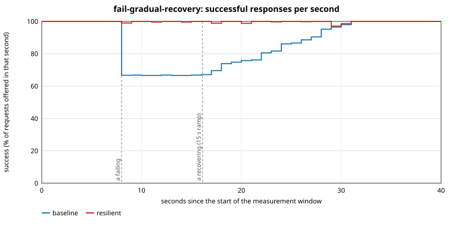

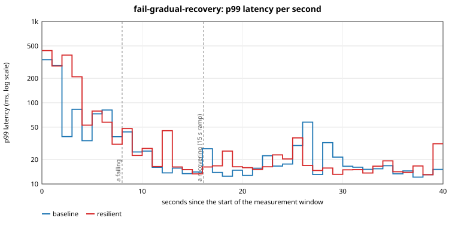

### fail-outage

Upstream a becomes completely unavailable (the process stops listening, connections are refused) at 8 s and comes back at 24 s. Baseline: no retries or breaker. Resilient: retries, circuit breaker, passive health.

| t (s) | event | detail |
| --- | --- | --- |
| 8.0 | a down | a: {refuse=true} |
| 24.0 | a restored | a: {refuse=false} |

| variant | phase | runs | success % | upstream-originated error % | proxy-generated error % | transport error % | p99 latency ms (worst second) |
| --- | --- | --- | --- | --- | --- | --- | --- |
| baseline | before fault | 2 | 100.0 | 0.0 | 0.0 | 0.0 | 490.5 |
| baseline | during fault | 2 | 66.7 | 0.0 | 33.3 | 0.0 | 58.1 |
| baseline | after recovery event | 2 | 99.9 | 0.0 | 0.1 | 0.0 | 39.1 |
| resilient | before fault | 2 | 100.0 | 0.0 | 0.0 | 0.0 | 392.2 |
| resilient | during fault | 2 | 100.0 | 0.0 | 0.0 | 0.0 | 66.4 |
| resilient | after recovery event | 2 | 100.0 | 0.0 | 0.0 | 0.0 | 22.7 |

| variant | whole window: proxy-generated % (upstream-caused / protective) | retry amplification (upstream attempts per request) | recovery time | shadow queue max | shadow dropped | breaker transitions |
| --- | --- | --- | --- | --- | --- | --- |
| baseline | 13.4 / 0.0 | 1.000 | 0.9 s | 0 | 0 | 0 |
| resilient | 0.0 / 0.0 | 1.000 | 0.0 s | 0 | 0 | 0 |

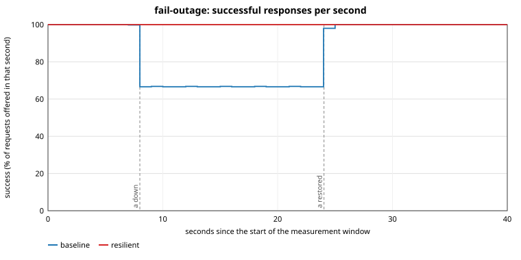

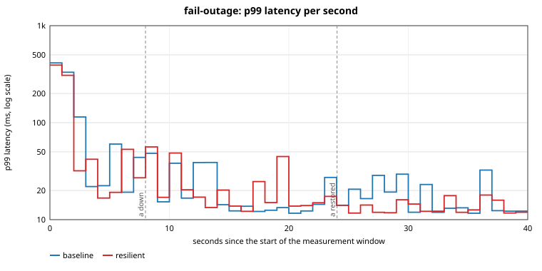

### fail-retry-amplification

All three upstreams start failing half of their requests with 503 from 8 s to 24 s. Compares no retries, up to 3 attempts with an effectively unlimited retry budget, and up to 3 attempts with a 10% retry budget: retry amplification (upstream attempts per client request) and what it buys.

| t (s) | event | detail |
| --- | --- | --- |
| 8.0 | all upstreams 50% 503 | a: {errorRate=0.5, errorStatus=503} |
| 8.1 | b 50% 503 | b: {errorRate=0.5, errorStatus=503} |
| 8.1 | c 50% 503 | c: {errorRate=0.5, errorStatus=503} |
| 24.0 | all healthy | a: {errorRate=0.0} |
| 24.0 | b healthy | b: {errorRate=0.0} |
| 24.0 | c healthy | c: {errorRate=0.0} |

| variant | phase | runs | success % | upstream-originated error % | proxy-generated error % | transport error % | p99 latency ms (worst second) |
| --- | --- | --- | --- | --- | --- | --- | --- |
| no-retry | before fault | 2 | 100.0 | 0.1 | 0.0 | 0.0 | 613.4 |
| no-retry | during fault | 2 | 49.0 | 51.0 | 0.0 | 0.0 | 120.6 |
| no-retry | after recovery event | 2 | 99.9 | 0.1 | 0.0 | 0.0 | 74.6 |
| retry-budgeted | before fault | 2 | 100.0 | 0.0 | 0.0 | 0.0 | 294.4 |
| retry-budgeted | during fault | 2 | 55.2 | 44.8 | 0.0 | 0.0 | 74.0 |
| retry-budgeted | after recovery event | 2 | 100.0 | 0.1 | 0.0 | 0.0 | 66.8 |
| retry-unbudgeted | before fault | 2 | 100.0 | 0.0 | 0.0 | 0.0 | 679.9 |
| retry-unbudgeted | during fault | 2 | 86.5 | 13.5 | 0.0 | 0.0 | 117.8 |
| retry-unbudgeted | after recovery event | 2 | 99.9 | 0.1 | 0.0 | 0.0 | 39.3 |

| variant | whole window: proxy-generated % (upstream-caused / protective) | retry amplification (upstream attempts per request) | recovery time | shadow queue max | shadow dropped | breaker transitions |
| --- | --- | --- | --- | --- | --- | --- |
| no-retry | 0.0 / 0.0 | 1.000 | 0.5 s | 0 | 0 | 0 |
| retry-budgeted | 0.0 / 0.0 | 1.050 | 0.0 s | 0 | 0 | 0 |
| retry-unbudgeted | 0.0 / 0.0 | 1.308 | 0.4 s | 0 | 0 | 0 |

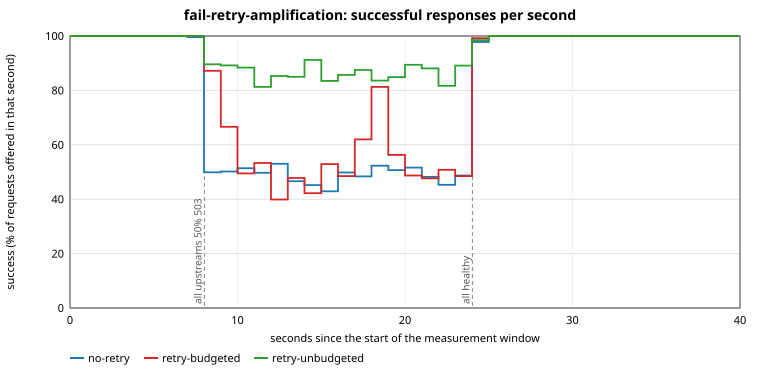

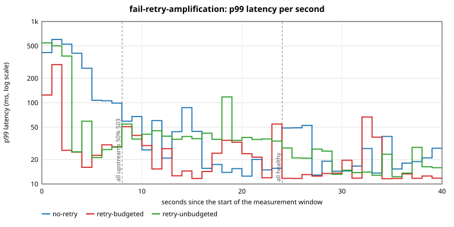

### fail-shadow-down

The shadow target becomes unavailable (connections refused) from 8 s to 24 s while 100% of requests are mirrored to it. Compares the primary path with and without shadowing: it must not change.

| t (s) | event | detail |
| --- | --- | --- |
| 8.0 | shadow down | s: {refuse=true} |
| 24.0 | shadow restored | s: {refuse=false} |

| variant | phase | runs | success % | upstream-originated error % | proxy-generated error % | transport error % | p99 latency ms (worst second) |
| --- | --- | --- | --- | --- | --- | --- | --- |
| no-shadow | before fault | 2 | 100.0 | 0.0 | 0.0 | 0.0 | 102.1 |
| no-shadow | during fault | 2 | 100.0 | 0.0 | 0.0 | 0.0 | 44.9 |
| no-shadow | after recovery event | 2 | 100.0 | 0.0 | 0.0 | 0.0 | 13.4 |
| shadow | before fault | 2 | 100.0 | 0.0 | 0.0 | 0.0 | 111.9 |
| shadow | during fault | 2 | 100.0 | 0.0 | 0.0 | 0.0 | 63.4 |
| shadow | after recovery event | 2 | 100.0 | 0.0 | 0.0 | 0.0 | 34.8 |

| variant | whole window: proxy-generated % (upstream-caused / protective) | retry amplification (upstream attempts per request) | recovery time | shadow queue max | shadow dropped | breaker transitions |
| --- | --- | --- | --- | --- | --- | --- |
| no-shadow | 0.0 / 0.0 | 1.000 | 0.0 s | 0 | 0 | 0 |
| shadow | 0.0 / 0.0 | 1.000 | 0.0 s | 0 | 0 | 0 |

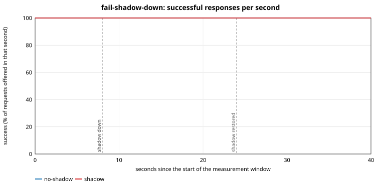

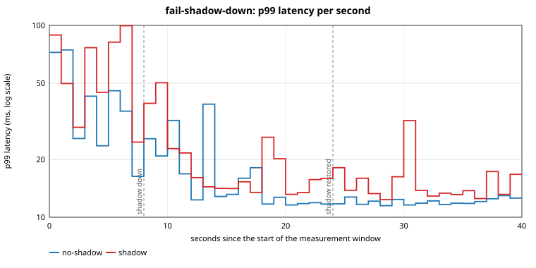

### fail-shadow-saturated

The shadow target becomes very slow (2 s per request) from 8 s to 24 s while 100% of requests are mirrored to it through a small queue (8) and 4 workers: the queue fills and the overflow is dropped; the primary must be unaffected.

| t (s) | event | detail |
| --- | --- | --- |
| 8.0 | shadow slow (2 s) | s: {delayMs=2000} |
| 24.0 | shadow normal | s: {delayMs=5, jitterMs=5} |

| variant | phase | runs | success % | upstream-originated error % | proxy-generated error % | transport error % | p99 latency ms (worst second) |
| --- | --- | --- | --- | --- | --- | --- | --- |
| no-shadow | before fault | 2 | 100.0 | 0.0 | 0.0 | 0.0 | 88.6 |
| no-shadow | during fault | 2 | 100.0 | 0.0 | 0.0 | 0.0 | 33.5 |
| no-shadow | after recovery event | 2 | 100.0 | 0.0 | 0.0 | 0.0 | 34.1 |
| shadow | before fault | 2 | 100.0 | 0.0 | 0.0 | 0.0 | 125.4 |
| shadow | during fault | 2 | 100.0 | 0.0 | 0.0 | 0.0 | 51.8 |
| shadow | after recovery event | 2 | 100.0 | 0.0 | 0.0 | 0.0 | 49.3 |

| variant | whole window: proxy-generated % (upstream-caused / protective) | retry amplification (upstream attempts per request) | recovery time | shadow queue max | shadow dropped | breaker transitions |
| --- | --- | --- | --- | --- | --- | --- |
| no-shadow | 0.0 / 0.0 | 1.000 | 0.0 s | 0 | 0 | 0 |
| shadow | 0.0 / 0.0 | 1.000 | 0.0 s | 8 | 8371 | 0 |

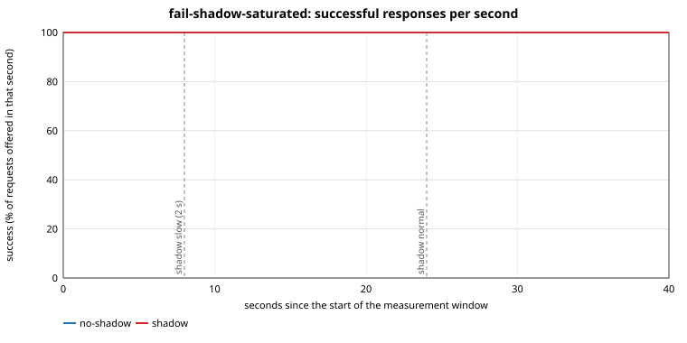

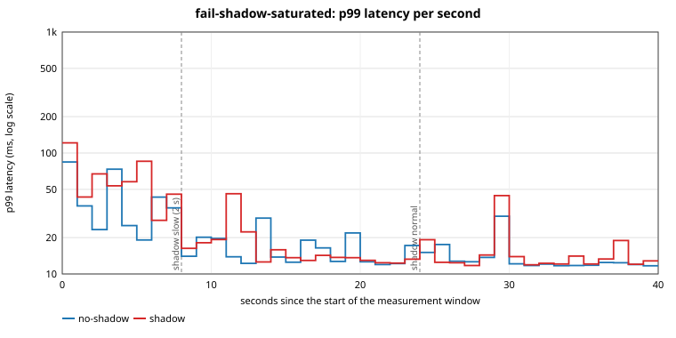

### fail-slow

Upstream a becomes 500 ms slower from 8 s to 24 s; the route's response timeout is 300 ms, so its answers time out.

| t (s) | event | detail |
| --- | --- | --- |
| 8.0 | a +500 ms | a: {delayMs=505, jitterMs=5} |
| 24.0 | a normal | a: {delayMs=5, jitterMs=5} |

| variant | phase | runs | success % | upstream-originated error % | proxy-generated error % | transport error % | p99 latency ms (worst second) |
| --- | --- | --- | --- | --- | --- | --- | --- |
| baseline | before fault | 2 | 100.0 | 0.0 | 0.0 | 0.0 | 353.8 |
| baseline | during fault | 2 | 66.7 | 0.0 | 33.3 | 0.0 | 320.5 |
| baseline | after recovery event | 2 | 99.9 | 0.0 | 0.1 | 0.0 | 169.1 |
| resilient | before fault | 2 | 100.0 | 0.0 | 0.0 | 0.0 | 247.3 |
| resilient | during fault | 2 | 100.0 | 0.0 | 0.0 | 0.0 | 368.6 |
| resilient | after recovery event | 2 | 100.0 | 0.0 | 0.0 | 0.0 | 56.6 |

| variant | whole window: proxy-generated % (upstream-caused / protective) | retry amplification (upstream attempts per request) | recovery time | shadow queue max | shadow dropped | breaker transitions |
| --- | --- | --- | --- | --- | --- | --- |
| baseline | 13.4 / 0.0 | 1.000 | 0.5 s | 0 | 0 | 0 |
| resilient | 0.0 / 0.0 | 1.003 | 0.0 s | 0 | 0 | 11 |

Breaker transitions in run 1 of `fail-slow@resilient`: a closed->open at 8.4s (failure_rate_exceeded); a open->half_open at 11.6s (open_duration_elapsed); a half_open->open at 11.9s (probe_failed); a open->half_open at 14.9s (open_duration_elapsed); a half_open->open at 15.2s (probe_failed); a open->half_open at 18.3s (open_duration_elapsed); a half_open->open at 18.6s (probe_failed); a open->half_open at 21.6s (open_duration_elapsed); a half_open->open at 21.9s (probe_failed); a open->half_open at 24.9s (open_duration_elapsed); a half_open->closed at 24.9s (recovered)

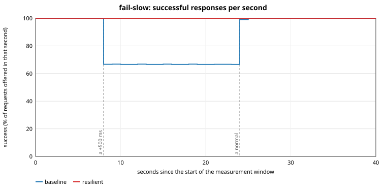

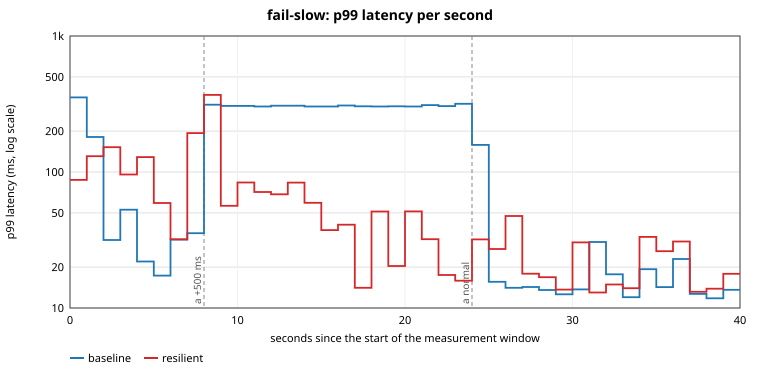

## Limitations

- Single machine, shared CPUs, small core count: saturation happens early and the load generator is part of the load. Do not read the numbers as capacity figures for other hardware.
- Loopback networking only: no network latency, packet loss or bandwidth limits.
- Upstreams are the fault-injection upstream, not real applications; their service time is a configured delay.
- A handful of repetitions per point: ranges are shown, but this is not a statistical significance test.
- The JDK HTTP stack hides connection-pool details; connection counts are the kernel's view (`/proc/net/tcp`) attributed by port.
- Active health checks and DNS are not stressed by these scenarios.

